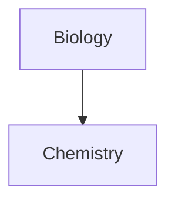

# Obsidian Flavored Markdown Spec

**Version:** 0.1 (draft)
**Date:** 2026-11-10
**Base specifications:** [CommonMark 0.31.2](https://spec.commonmark.org/0.31.2/), [GitHub Flavored Markdown 0.29-gfm](https://github.github.com/gfm/)

This is an independent, unofficial specification. It is not published or endorsed by Obsidian. It describes the syntax documented in the Obsidian help as of the date above.

## Contents

1. [Introduction](#1-introduction)
2. [Preliminaries](#2-preliminaries)
3. [Blocks and inlines](#3-blocks-and-inlines)
4. [Properties (front matter)](#4-properties-front-matter)
5. [Leaf blocks](#5-leaf-blocks)
6. [Container blocks](#6-container-blocks)
7. [Inlines](#7-inlines)
8. [Link resolution](#8-link-resolution)
9. [Unsupported syntax and non-goals](#9-unsupported-syntax-and-non-goals)
- [Appendix A: A parsing strategy](#appendix-a-a-parsing-strategy)
- [Appendix B: Differences from CommonMark and GFM](#appendix-b-differences-from-commonmark-and-gfm)
- [Appendix C: Open questions](#appendix-c-open-questions)
- [Appendix D: Sources](#appendix-d-sources)

---

## 1 Introduction

### 1.1 What is Obsidian Flavored Markdown?

Obsidian Flavored Markdown (OFM) is the Markdown dialect read and written by the [Obsidian](https://obsidian.md) note-taking application. Obsidian describes it as a combination of CommonMark, GitHub Flavored Markdown, and LaTeX, plus syntax of its own such as internal links, embeds, block identifiers, comments, highlights, and callouts.

A set of OFM files lives in a [vault](#vault). Unlike CommonMark, some OFM constructs have meaning only relative to the vault, such as a link to another note by name.

### 1.2 Why is a spec needed?

Obsidian's help pages describe OFM by example, and Obsidian's parser is not open source. Tools that read or write vaults must therefore guess at questions such as:

- Does `abc#def` contain a tag?
- Which takes precedence in a table cell, the `|` of a wikilink alias or the `|` of a column?
- Where does a comment that is never closed end?
- What does `^id` attach to when it follows a list?

This document gives one precise answer to each such question and says how well supported that answer is.

### 1.3 Relationship to CommonMark and GFM

OFM is defined as a set of changes to CommonMark 0.31.2, plus GFM's tables, task list items, strikethrough, and autolinks. OFM also has footnotes, which GitHub's renderer supports but the GFM spec does not define, so [section 6.3](#63-footnote-definitions) defines them in full. Each extension is restated here wherever OFM differs. **Any behavior this document does not address is as defined by CommonMark.** [Appendix B](#appendix-b-differences-from-commonmark-and-gfm) lists every difference.

An implementation should expect to pass the CommonMark test suite with [strict line breaks](#strict-line-breaks) on, except for examples whose input contains an OFM construct. For example, CommonMark's tests for `[[foo]]` as nested brackets differ, because in OFM that text is a wikilink.

### 1.4 Conformance and provenance

The key words MUST, MUST NOT, SHOULD, SHOULD NOT, and MAY are to be interpreted as described in RFC 2119. All rules are normative for implementations of this spec, whatever their provenance.

Obsidian's own behavior is known with varying confidence, so rules carry a provenance mark:

| Mark | Meaning |
| --- | --- |
| *(no mark)* | Stated in the Obsidian help or API documentation, or inherited from CommonMark or GFM. |
| ***[reported]*** | Not stated by Obsidian. Based on user reports, third-party tools, or how the official help vault's own source is written. |
| ***[chosen]*** | Obsidian's behavior is undocumented. This spec fixes a rule so that implementations agree. Obsidian may behave differently. |

**Apart from a manual check of colored highlights ([section 7.2](#72-highlights)), no example in this document has been run against Obsidian itself.** Rules marked *[chosen]* in particular are the first candidates for correction. [Appendix C](#appendix-c-open-questions) lists what most needs testing.

### 1.5 About this document

Like CommonMark, this document alternates prose with numbered examples. Each example shows Markdown input, a line containing a single `.`, and the expected HTML output. The `→` character represents a tab.

The HTML is a **canonical rendering**. It represents structure for testing and is not the DOM that Obsidian produces, which has additional attributes, icons, and wrappers. Conforming implementations need not produce HTML at all. When comparing against the examples, attribute order is not significant.

Examples use a block format compatible with CommonMark's `spec.txt`, so they can be extracted mechanically: an opening fence of 32 backticks with the info string `example`, and a closing fence of 32 backticks.

### 1.6 Views

Obsidian displays a note in one of three views: **Reading view** (fully rendered), **Live Preview** (rendered around the cursor while editing), and **Source mode** (plain text). The views do not always agree. For example, inline footnotes work only in Reading view, and syntax highlighting differs between them.

**This specification defines Reading view.** Differences in other views are noted where they are documented.

---

## 2 Preliminaries

### 2.1 Characters and lines

Characters, lines, line endings, blank lines, tabs, and the replacement of U+0000 are as defined in CommonMark section 2. The character classes [Unicode whitespace character](https://spec.commonmark.org/0.31.2/#unicode-whitespace-character), [ASCII punctuation character](https://spec.commonmark.org/0.31.2/#ascii-punctuation-character), and [Unicode punctuation character](https://spec.commonmark.org/0.31.2/#unicode-punctuation-character) have their CommonMark meanings.

A byte order mark at the start of a file MUST be ignored. ***[chosen]***

### 2.2 Vault terms

<a id="vault"></a>A **vault** is a folder of files treated as one collection. Paths in a vault use `/` as the separator on every platform and are relative to the vault's root.

A **note** is a vault file with the extension `.md`.

An **attachment** is any other vault file. The accepted formats are:

| Kind | Extensions |
| --- | --- |
| Markdown | `.md` |
| Bases | `.base` |
| JSON Canvas | `.canvas` |
| Image | `.avif` `.bmp` `.gif` `.jpeg` `.jpg` `.png` `.svg` `.webp` |
| Audio | `.flac` `.m4a` `.mp3` `.ogg` `.wav` `.webm` `.3gp` |
| Video | `.mkv` `.mov` `.mp4` `.ogv` `.webm` |
| PDF | `.pdf` |

`.webm` is listed for both audio and video. How an implementation chooses between them is not specified.

### 2.3 Settings

One user setting changes how a note parses:

<a id="strict-line-breaks"></a>**Strict line breaks** (default: off) controls [soft line breaks](#71-inherited-inlines-and-line-breaks). Examples in this document assume it is off.

Other settings, such as **Use [[Wikilinks]]** and **Properties in document**, affect only what the application generates or displays. They MUST NOT change how a document parses.

### 2.4 Backslash escapes

CommonMark's backslash escapes apply. Because `%`, `=`, `$`, `^`, `~`, `|`, and `#` are ASCII punctuation, each OFM construct can be escaped by putting a backslash before its opening character.

**Example 1**

```````````````````````````````` example
\%%not a comment\%%

\==not a highlight\==

\#not-a-tag

\$not math\$

\[[not a link]]
.
<p>%%not a comment%%</p>
<p>==not a highlight==</p>
<p>#not-a-tag</p>
<p>$not math$</p>
<p>[[not a link]]</p>
````````````````````````````````

---

## 3 Blocks and inlines

### 3.1 Document structure

A document consists of an optional [front matter](#4-properties-front-matter) block followed by a body. The body is a sequence of blocks, parsed as in CommonMark with the additions in sections 5 and 6.

### 3.2 Precedence

As in CommonMark, **indicators of block structure always take precedence over indicators of inline structure.** So a table's column boundaries are determined before any wikilink inside a cell is recognized ([section 5.4](#54-tables)), and a line of `==` after a paragraph is a setext heading underline and not a highlight.

**Example 2**

```````````````````````````````` example
Heading
==
.
<h1>Heading</h1>
````````````````````````````````

Among inlines, the following constructs bind more tightly than emphasis, in the way CommonMark code spans do: code spans, [inline comments](#74-inline-comments), [inline math](#75-inline-math), [wikilinks](#77-wikilinks), [embeds](#78-embeds), raw HTML, and autolinks. When two of them overlap, **the one whose opening delimiter comes first wins.** ***[chosen]***

**Example 3**

```````````````````````````````` example
`%%code%%` and %%`comment`%% end

*[[a*b]]*
.
<p><code>%%code%%</code> and  end</p>
<p><em><a class="internal-link" data-href="a*b" href="a*b">a*b</a></em></p>
````````````````````````````````

### 3.3 Inherited constructs

The following are unchanged from CommonMark, except as noted in the listed section: thematic breaks, ATX and setext headings, indented code blocks, fenced code blocks ([5.1](#51-fenced-code-blocks)), HTML blocks ([5.5](#55-html-blocks)), link reference definitions, paragraphs ([5.6](#56-block-identifiers)), block quotes ([6.1](#61-callouts)), lists ([6.2](#62-task-list-items)), code spans, emphasis and strong emphasis, links, images ([7.9](#79-images-with-dimensions)), autolinks, raw HTML, and hard line breaks.

**Example 4**

```````````````````````````````` example
**Bold text and _nested italic_ text**

***Bold and italic text***
.
<p><strong>Bold text and <em>nested italic</em> text</strong></p>
<p><em><strong>Bold and italic text</strong></em></p>
````````````````````````````````

---

## 4 Properties (front matter)

<a id="front-matter"></a>A **front matter** block stores a note's properties. It MUST begin on the first line of the file. Its first line is exactly `---`, and it ends at the next line that is exactly `---`. Trailing spaces and tabs on these two lines are allowed. ***[chosen]*** Everything between the two lines is the **front matter content**, which is not parsed as Markdown.

If no closing line exists, the file has no front matter and the first line is an ordinary thematic break. ***[chosen]***

A front matter block produces no rendered output.

**Example 5**

```````````````````````````````` example
---
title: A New Hope
tags:
  - journal
---
# Heading
.
<h1>Heading</h1>
````````````````````````````````

`---` elsewhere in a file is not front matter:

**Example 6**

```````````````````````````````` example

---
title: not front matter
---
.
<hr />
<h2>title: not front matter</h2>
````````````````````````````````

The content is [YAML](https://yaml.org/). It MAY instead be a single [JSON](https://www.json.org/) object, which a YAML parser can also read. Obsidian reads JSON front matter and saves it back as YAML.

Content that cannot be parsed yields no properties. It is still consumed as front matter, and the body is unaffected. ***[chosen]***

### 4.1 Property values

Each top-level key is a **property name**. Names MUST be unique within a note. The value MAY be text, a number, a boolean, a date, a date and time, or a list.

| Type | YAML form | Example |
| --- | --- | --- |
| Text | Single-line string | `title: A New Hope` |
| List | Block sequence | `cast:` followed by `  - Mark Hamill` |
| Number | Integer or decimal literal, never an expression | `year: 1977` |
| Checkbox | `true`, `false`, or empty | `favorite: true` |
| Date | `YYYY-MM-DD` | `date: 2020-08-21` |
| Date & time | `YYYY-MM-DDTHH:MM:SS` | `time: 2020-08-21T10:30:00` |
| Tags | Block sequence, for the `tags` property only | `tags:` followed by `  - journal` |

A property's type in Obsidian is assigned per name across the vault. The type is therefore not determined by the syntax of any one file, and a parser can only report the YAML value.

Values are not Markdown. A `#word` in a text property does not create a tag. Nested mappings are valid YAML but are not displayed by the Properties UI.

### 4.2 Links in properties

A text or list value MAY be an internal link. Such values MUST be quoted, because an unquoted `[[Link]]` is a nested YAML sequence. A value that consists of one wikilink is a **front matter link**.

```yaml
---
link: "[[Episode IV]]"
links:
  - "[[Link]]"
  - "[[Link2]]"
---
```

### 4.3 Default properties

| Property | Type | Meaning |
| --- | --- | --- |
| `tags` | List | The note's [tags](#76-tags). Values are written without the leading `#`. |
| `aliases` | List | Alternative names for the note. See [section 8.5](#85-aliases). |
| `cssclasses` | List | CSS classes applied to the note. |

The properties `tag`, `alias`, and `cssclass` are deprecated forms of these, and Obsidian 1.9 dropped support for them as default properties.

For Obsidian Publish, `publish`, `permalink`, `description`, `image`, and `cover` also have defined meanings.

---

## 5 Leaf blocks

### 5.1 Fenced code blocks

Fenced code blocks are as in CommonMark. The first word of the info string is the language, used for syntax highlighting. Obsidian's Reading view uses Prism and its language names.

**Example 7**

```````````````````````````````` example
```js
const a = "**not bold** [[not a link]] %%not a comment%%";
```
.
<pre><code class="language-js">const a = &quot;**not bold** [[not a link]] %%not a comment%%&quot;;
</code></pre>
````````````````````````````````

The following languages have special meaning. An application that implements them replaces the code block with the described result. A parser MUST still report them as ordinary fenced code blocks with their literal content.

| Language | Result | Content |
| --- | --- | --- |
| `mermaid` | Diagram | [Mermaid](https://mermaid.js.org/) source. Nodes with the class `internal-link` become internal links whose target is the node's text. Those links do not appear in the graph. |
| `query` | Embedded search results | An Obsidian search query, such as `embed OR search`. |
| `base` | Embedded [Bases](https://obsidian.md/help/bases/syntax) view | YAML. Top-level keys are `filters`, `formulas`, `properties`, `summaries`, and `views`. |

Community plugins MAY register further languages. They are out of scope.

**Example 8**

```````````````````````````````` example

.
<pre><code class="language-mermaid">graph TD
Biology --&gt; Chemistry
</code></pre>
````````````````````````````````

### 5.2 Math blocks

<a id="math-block"></a>A **math block** begins with a line whose content, after at most 3 spaces of indentation, starts with `$$` and has no further `$$` on that line. It ends at the next line containing `$$`, or at the end of its container if there is none. ***[reported]*** Text before the closing `$$` belongs to the math block. Blank lines MAY appear inside. ***[chosen]***

The content is LaTeX as understood by [MathJax](https://docs.mathjax.org/). It is not parsed as Markdown, and its leading and trailing whitespace is removed. A math block can interrupt a paragraph. ***[chosen]***

**Example 9**

```````````````````````````````` example
$$
\begin{vmatrix}a & b\\
c & d
\end{vmatrix}=ad-bc
$$
.
<div class="math math-block">\begin{vmatrix}a &amp; b\\
c &amp; d
\end{vmatrix}=ad-bc</div>
````````````````````````````````

A line such as `$$x$$`, which opens and closes on one line, is parsed as [inline display math](#75-inline-math).

### 5.3 Block comments

<a id="block-comment"></a>A **block comment** begins with a line whose content, after at most 3 spaces of indentation ***[chosen]***, starts with `%%` and has no further `%%` on that line. It ends at the next `%%`, wherever that occurs in a line. Its content is discarded, including any blank lines, headings, or lists it contains. A block comment can interrupt a paragraph.

**Example 10**

```````````````````````````````` example
Before

%%
This is a block comment.

# Not a heading

- not a list
%%

After
.
<p>Before</p>
<p>After</p>
````````````````````````````````

Text after the closing `%%` remains in the document. The remainder of that line is parsed as if it were the start of a new line in the same container.

**Example 11**

```````````````````````````````` example
%%
hidden
%% _italic_
.
<p><em>italic</em></p>
````````````````````````````````

A block comment that is never closed hides the rest of its container. At the top level, that is the rest of the note.

**Example 12**

```````````````````````````````` example
Visible

%%
Hidden

Also hidden
.
<p>Visible</p>
````````````````````````````````

Within a container such as a list item or block quote, a block comment ends when the container ends, as a fenced code block does. ***[chosen]***

A line that begins with `%%` and closes on the same line is an [inline comment](#74-inline-comments) in a paragraph.

### 5.4 Tables

Tables are as in GFM: a header row, a delimiter row, and zero or more data rows. Leading and trailing `|` are optional.

**Example 13**

```````````````````````````````` example
| First name | Last name |
| ---------- | --------- |
| Max        | Planck    |
.
<table>
<thead>
<tr>
<th>First name</th>
<th>Last name</th>
</tr>
</thead>
<tbody>
<tr>
<td>Max</td>
<td>Planck</td>
</tr>
</tbody>
</table>
````````````````````````````````

**Example 14**

```````````````````````````````` example
Left | Center | Right
:-- | :--: | --:
a | b | c
.
<table>
<thead>
<tr>
<th align="left">Left</th>
<th align="center">Center</th>
<th align="right">Right</th>
</tr>
</thead>
<tbody>
<tr>
<td align="left">a</td>
<td align="center">b</td>
<td align="right">c</td>
</tr>
</tbody>
</table>
````````````````````````````````

Each delimiter cell needs at least one hyphen, as in GFM. The Obsidian help says at least two are required, but the help's own pages use `|-|-|`. ***[reported]*** Authors SHOULD write at least two.

Rows are split into cells before inline parsing, so any `|` not preceded by a backslash ends a cell, even inside a wikilink or code span. As in GFM, `\|` in a cell yields a literal `|` for the inline parser. So wikilink aliases and image sizes in a table MUST be written with `\|`.

**Example 15**

```````````````````````````````` example
a | b
-- | --
[[Note\|Alias]] | ![[pic.png\|200]]
.
<table>
<thead>
<tr>
<th>a</th>
<th>b</th>
</tr>
</thead>
<tbody>
<tr>
<td><a class="internal-link" data-href="Note" href="Note">Alias</a></td>
<td></td>
</tr>
</tbody>
</table>
````````````````````````````````

Without the backslash, the wikilink is broken across two cells, and the excess cell is dropped as in GFM. Live Preview is reported to be more forgiving here than Reading view. ***[reported]***

**Example 16**

```````````````````````````````` example
| a |
| -- |
| [[Note|Alias]] |
.
<table>
<thead>
<tr>
<th>a</th>
</tr>
</thead>
<tbody>
<tr>
<td>[[Note</td>
</tr>
</tbody>
</table>
````````````````````````````````

### 5.5 HTML blocks

HTML blocks are recognized as in CommonMark. **Markdown is not parsed inside an HTML block.** In particular, the block ends at a blank line where CommonMark says it does, so HTML blocks that are meant to be whole SHOULD contain no blank lines.

**Example 17**

```````````````````````````````` example
<div>
This **will not** be bold.
</div>
.
<div>
This **will not** be bold.
</div>
````````````````````````````````

OFM wikilinks, tags, highlights, and comments are likewise not recognized inside an HTML block.

All HTML, block or inline, MUST be sanitized before display, because a note may come from an untrusted source. A sanitizer MUST remove `<script>` elements and other means of running script. It SHOULD keep common formatting elements, including `<div>`, `<span>` with `class` and `style`, `<u>`, `<s>`, `<sub>`, `<sup>`, `<br>`, HTML comments, and `<iframe>`. The exact allow-list is not documented.

### 5.6 Block identifiers

<a id="block-identifier"></a>A **block identifier** names a block so that it can be [linked to](#84-block-subpaths). Its form is `^` followed by one or more Latin letters, digits, or hyphens (`[A-Za-z0-9-]+`).

A **block identifier marker** is a block identifier at the end of a line, optionally followed by spaces or tabs, and either at the start of the line or preceded by a space or tab. Markers are recognized only on the **last line** of a paragraph. The marker and any whitespace before it are removed from the paragraph.

If the paragraph has other content, the marker names that paragraph:

**Example 18**

```````````````````````````````` example
The quick purple gem dashes through the paragraph. ^37066d
.
<p data-block-id="37066d">The quick purple gem dashes through the paragraph.</p>
````````````````````````````````

The caret must be preceded by whitespace, and only the end of a line counts:

**Example 19**

```````````````````````````````` example
not-a-marker^abc

^abc is not at the end
.
<p>not-a-marker^abc</p>
<p>^abc is not at the end</p>
````````````````````````````````

The marker may stand on the paragraph's last line by itself. A blank line is not required before it. ***[reported]***

**Example 20**

```````````````````````````````` example
Some text
^abc
.
<p data-block-id="abc">Some text</p>
````````````````````````````````

If the marker is alone in its own paragraph, it names the **previous sibling block**, which is how lists, block quotes, callouts, and tables are named. The source SHOULD have a blank line before and after it.

**Example 21**

```````````````````````````````` example
- list item 1
- list item 2

^my-list-id
.
<ul data-block-id="my-list-id">
<li>list item 1</li>
<li>list item 2</li>
</ul>
````````````````````````````````

**Example 22**

```````````````````````````````` example
> A quotation.

^37066f

Next.
.
<blockquote data-block-id="37066f">
<p>A quotation.</p>
</blockquote>
<p>Next.</p>
````````````````````````````````

With no previous sibling, it is ordinary text. ***[chosen]***

**Example 23**

```````````````````````````````` example
^abc
.
<p>^abc</p>
````````````````````````````````

A marker in a list item's paragraph names that **list item**:

**Example 24**

```````````````````````````````` example
- Gemmy ^item-1
- Unhelpful assistant
.
<ul>
<li data-block-id="item-1">Gemmy</li>
<li>Unhelpful assistant</li>
</ul>
````````````````````````````````

**Example 25**

```````````````````````````````` example
- Gemmy
    ^37006f
- Unhelpful assistant
.
<ul>
<li data-block-id="37006f">Gemmy</li>
<li>Unhelpful assistant</li>
</ul>
````````````````````````````````

Parts of quotations and callouts cannot be linked. A marker in a paragraph inside a block quote or callout therefore names the **outermost enclosing** quote or callout. This includes a marker on a lazy continuation line, a form the official help vault uses. ***[reported]***

**Example 26**

```````````````````````````````` example
> [!tip] Tip
> Body
^my-callout
.
<div class="callout" data-callout="tip" data-block-id="my-callout">
<div class="callout-title">Tip</div>
<div class="callout-content">
<p>Body</p>
</div>
</div>
````````````````````````````````

Markers are not recognized in headings. ***[chosen]*** Use a [heading subpath](#83-heading-subpaths) to link to a heading.

**Example 27**

```````````````````````````````` example
# Heading ^abc
.
<h1>Heading ^abc</h1>
````````````````````````````````

If a note defines one identifier more than once, the first in document order is used. ***[chosen]***

---

## 6 Container blocks

### 6.1 Callouts

Block quotes are as in CommonMark, except that a block quote can be a callout.

<a id="callout"></a>A **callout** is a block quote whose first child is a paragraph whose first line matches:

```
^\[!([^\]|\s]+)(?:\|([^\]]*))?\]([+-]?)(?:[ \t]+(.*))?$
```

The captures are, in order:

1. The **type identifier**. It is case-insensitive and is normalized to lowercase.
2. **Metadata**, an optional string after `|` that themes can use for styling. The canonical rendering stores it in `data-callout-metadata`. ***[reported]***
3. The **fold marker**: `+` means foldable and expanded by default, `-` means foldable and collapsed by default, and no marker means not foldable.
4. The **title**, parsed as inline content. ***[chosen]***

This first line is removed from the paragraph. Remaining lines, and the remaining children of the block quote, are the callout's **content**. Content is parsed as ordinary blocks, so callouts can contain lists, code, wikilinks, and embeds.

**Example 28**

```````````````````````````````` example
> [!info] Here's a callout title
> Here's a callout block.
.
<div class="callout" data-callout="info">
<div class="callout-title">Here's a callout title</div>
<div class="callout-content">
<p>Here's a callout block.</p>
</div>
</div>
````````````````````````````````

With no title, the default title is the type identifier in title case, meaning its first character is uppercased and the rest stays lowercase. ***[chosen for identifiers with several words]***

**Example 29**

```````````````````````````````` example
> [!WARNING]
> Careful.
.
<div class="callout" data-callout="warning">
<div class="callout-title">Warning</div>
<div class="callout-content">
<p>Careful.</p>
</div>
</div>
````````````````````````````````

A callout may have no content:

**Example 30**

```````````````````````````````` example
> [!tip] Title-only callout
.
<div class="callout" data-callout="tip">
<div class="callout-title">Title-only callout</div>
</div>
````````````````````````````````

The fold marker must directly follow `]`:

**Example 31**

```````````````````````````````` example
> [!faq]- Are callouts foldable?
> Yes!
.
<div class="callout" data-callout="faq" data-callout-fold="-">
<div class="callout-title">Are callouts foldable?</div>
<div class="callout-content">
<p>Yes!</p>
</div>
</div>
````````````````````````````````

Callouts can nest:

**Example 32**

```````````````````````````````` example
> [!question] Can callouts be nested?
> > [!todo] Yes!, they can.
.
<div class="callout" data-callout="question">
<div class="callout-title">Can callouts be nested?</div>
<div class="callout-content">
<div class="callout" data-callout="todo">
<div class="callout-title">Yes!, they can.</div>
</div>
</div>
</div>
````````````````````````````````

A first line that does not match leaves an ordinary block quote. In the first quote below, the marker is not at the start of the line. In the second, text follows the `]` with no space. ***[chosen]***

**Example 33**

```````````````````````````````` example
> See [!info] here

> [!info]nospace
.
<blockquote>
<p>See [!info] here</p>
</blockquote>
<blockquote>
<p>[!info]nospace</p>
</blockquote>
````````````````````````````````

#### Callout types

An identifier outside this table is still a callout. It takes the appearance of `note` unless a stylesheet defines it, using a selector such as `.callout[data-callout="custom-question-type"]`. The original identifier MUST be preserved, including when it is an alias.

| Type | Aliases |
| --- | --- |
| `note` | |
| `abstract` | `summary`, `tldr` |
| `info` | |
| `todo` | |
| `tip` | `hint`, `important` |
| `success` | `check`, `done` |
| `question` | `help`, `faq` |
| `warning` | `caution`, `attention` |
| `failure` | `fail`, `missing` |
| `danger` | `error` |
| `bug` | |
| `example` | |
| `quote` | `cite` |

### 6.2 Task list items

Lists are as in CommonMark. In addition, a list item of any list type is a **task list item** if its first paragraph begins with `[`, exactly one character, `]`, and then a space, tab, or end of line.

Unlike GFM, the character may be anything. A space means the task is incomplete. **Any other character means it is complete.** The character is preserved so that themes and plugins can distinguish statuses. The canonical rendering stores it in `data-task`, which is empty for a space.

**Example 34**

```````````````````````````````` example
- [x] Done
- [ ] Not done
- [?] Question
- [-] Cancelled
.
<ul>
<li class="task-list-item" data-task="x"><input type="checkbox" disabled="" checked="" /> Done</li>
<li class="task-list-item" data-task=""><input type="checkbox" disabled="" /> Not done</li>
<li class="task-list-item" data-task="?"><input type="checkbox" disabled="" checked="" /> Question</li>
<li class="task-list-item" data-task="-"><input type="checkbox" disabled="" checked="" /> Cancelled</li>
</ul>
````````````````````````````````

Brackets holding zero characters, or more than one, are ordinary text:

**Example 35**

```````````````````````````````` example
- [] empty
- [ab] two
.
<ul>
<li>[] empty</li>
<li>[ab] two</li>
</ul>
````````````````````````````````

Task list items can be nested under, or contain, any kind of list.

### 6.3 Footnote definitions

<a id="footnote-definition"></a>A **footnote definition** is a container that begins with `[^`, a **footnote label**, `]:`, and optional whitespace, indented by at most 3 spaces. A label is one or more characters and contains no whitespace or `]`. A definition can interrupt a paragraph, so several may appear on consecutive lines. ***[chosen]***

A following line belongs to the definition if it is blank or is indented by at least **2 spaces**. GitHub's renderer requires 4. Paragraph continuation text may also be lazy, as in a list item. Labels match case-insensitively, as CommonMark link labels do. ***[chosen]***

Definitions render together at the end of the document, in the order of first reference, and are numbered from 1 whatever their labels are. A definition that is never referenced is not rendered. ***[chosen]***

**Example 36**

```````````````````````````````` example
Simple[^1] and named[^note].

[^1]: The first.
  It spans lines.
[^note]: Named footnotes appear as numbers.
.
<p>Simple<sup class="footnote-ref"><a href="#fn-1" id="fnref-1">1</a></sup> and named<sup class="footnote-ref"><a href="#fn-2" id="fnref-2">2</a></sup>.</p>
<section class="footnotes">
<ol>
<li id="fn-1">
<p>The first.<br />
It spans lines. <a href="#fnref-1" class="footnote-backref">↩</a></p>
</li>
<li id="fn-2">
<p>Named footnotes appear as numbers. <a href="#fnref-2" class="footnote-backref">↩</a></p>
</li>
</ol>
</section>
````````````````````````````````

---

## 7 Inlines

### 7.1 Inherited inlines and line breaks

Inline parsing is as in CommonMark, with the additions in this section.

<a id="soft-line-break"></a>**Soft line breaks.** With [strict line breaks](#strict-line-breaks) off, which is the default, a line ending that CommonMark treats as a soft line break renders as a hard line break. With the setting on, CommonMark's behavior applies. Obsidian's help text is ambiguous about the default, and users report that the setting has no effect in Live Preview. ***[reported]***

**Example 37**

```````````````````````````````` example
line one
line two
.
<p>line one<br />
line two</p>
````````````````````````````````

A trailing backslash or two trailing spaces also produce a hard line break, under either setting.

### 7.2 Highlights

<a id="highlight"></a>A **highlight** is text wrapped in `==`. It is parsed with the delimiter algorithm CommonMark uses for emphasis. Only runs of exactly two `=` can act as delimiters, an opener must be left-flanking, a closer must be right-flanking, and highlights do not combine with other delimiter types. ***[chosen]*** Highlight content can contain other inlines.

**Example 38**

```````````````````````````````` example
==Highlighted **text**==

**==Bold highlight==**
.
<p><mark>Highlighted <strong>text</strong></mark></p>
<p><strong><mark>Bold highlight</mark></strong></p>
````````````````````````````````

**Example 39**

```````````````````````````````` example
a == b == c

===three===

== spaced ==
.
<p>a == b == c</p>
<p>===three===</p>
<p>== spaced ==</p>
````````````````````````````````

A highlight whose content starts with one of these six emoji has that color. The emoji is a marker and is removed from the content. ***[reported]***

| Emoji | Color |
| --- | --- |
| 🔴 | red |
| 🟠 | orange |
| 🟡 | yellow |
| 🟢 | green |
| 🔵 | blue |
| 🟣 | purple |

**Example 40**

```````````````````````````````` example
==🔴Important==
.
<p><mark data-highlight-color="red">Important</mark></p>
````````````````````````````````

### 7.3 Strikethrough

Strikethrough uses `~~`. Unlike GFM, a single `~` is not a delimiter. ***[chosen]***

**Example 41**

```````````````````````````````` example
~~Striked out text~~ and ~not struck~
.
<p><del>Striked out text</del> and ~not struck~</p>
````````````````````````````````

### 7.4 Inline comments

<a id="inline-comment"></a>An **inline comment** begins with `%%` and ends at the next `%%` on the same line. Its content is discarded. It can appear anywhere inlines are parsed, including headings, list items, and bold text.

Obsidian's help advises keeping both markers on one line. A `%%` with no closer on its line is literal text, unless it begins a line, in which case it starts a [block comment](#block-comment). ***[chosen]***

**Example 42**

```````````````````````````````` example
This is an %%inline%% comment.

**Bold %%hidden%% text**

# Heading %%hidden%%
.
<p>This is an  comment.</p>
<p><strong>Bold  text</strong></p>
<h1>Heading</h1>
````````````````````````````````

**Example 43**

```````````````````````````````` example
Discount of 10%% today
.
<p>Discount of 10%% today</p>
````````````````````````````````

Text after the comment is still parsed:

**Example 44**

```````````````````````````````` example
%%comment%% _italic_
.
<p><em>italic</em></p>
````````````````````````````````

Spaces and tabs left at the start or end of a paragraph or heading by removing a comment are removed. A paragraph that contains only comments produces no output. ***[chosen]***

**Example 45**

```````````````````````````````` example
%%only a comment%%
.
````````````````````````````````

Comments are removed from Reading view but remain visible in the editing views. A renderer that exports notes MUST NOT include comment content in its output.

### 7.5 Inline math

<a id="inline-math"></a>**Inline math** begins with a `$` that is not followed by whitespace, and ends at the next `$` that is not preceded by whitespace or a backslash. Both delimiters must be on the same line. ***[reported for whitespace; chosen for the rest]*** The content is LaTeX and is not parsed as Markdown.

**Example 46**

```````````````````````````````` example
Inline $e^{2i\pi} = 1$ math.
.
<p>Inline <span class="math math-inline">e^{2i\pi} = 1</span> math.</p>
````````````````````````````````

**Example 47**

```````````````````````````````` example
It costs $ 5 or $5 and more.

Escaped \$5 and \$6.
.
<p>It costs $ 5 or $5 and more.</p>
<p>Escaped $5 and $6.</p>
````````````````````````````````

Dollar amounts with a closing candidate on the same line are math. Authors SHOULD escape them.

**Example 48**

```````````````````````````````` example
$100/$200
.
<p><span class="math math-inline">100/</span>200</p>
````````````````````````````````

**Inline display math** is `$$`, content, `$$` on a single line, anywhere that inlines are parsed. It is rendered in display style. ***[chosen]***

**Example 49**

```````````````````````````````` example
$$x^2$$

Before $$y$$ after
.
<p><span class="math math-display">x^2</span></p>
<p>Before <span class="math math-display">y</span> after</p>
````````````````````````````````

### 7.6 Tags

<a id="tag"></a>A **tag** is `#` followed by one or more tag characters, with at least one that is not a decimal digit.

A **tag character** is a Unicode letter, mark, or number; `_`; `-`; `/`; or an emoji or other Unicode symbol outside ASCII. Tag characters do not include spaces or any other ASCII punctuation. The tag ends at the first character that is not a tag character.

**Example 50**

```````````````````````````````` example
#meeting #inbox/to-read #snake_case #kebab-case #y1984 #日本語
.
<p><a class="tag" href="#meeting">#meeting</a> <a class="tag" href="#inbox/to-read">#inbox/to-read</a> <a class="tag" href="#snake_case">#snake_case</a> <a class="tag" href="#kebab-case">#kebab-case</a> <a class="tag" href="#y1984">#y1984</a> <a class="tag" href="#日本語">#日本語</a></p>
````````````````````````````````

**Example 51**

```````````````````````````````` example
#1984
.
<p>#1984</p>
````````````````````````````````

**Example 52**

```````````````````````````````` example
Ends at punctuation: #tag. And #bob's.
.
<p>Ends at punctuation: <a class="tag" href="#tag">#tag</a>. And <a class="tag" href="#bob">#bob</a>'s.</p>
````````````````````````````````

A tag MUST be at the start of the inline content, or preceded by whitespace or by another tag. ***[reported]***

**Example 53**

```````````````````````````````` example
abc#def is not a tag.

#Bob#Alice is two.
.
<p>abc#def is not a tag.</p>
<p><a class="tag" href="#Bob">#Bob</a><a class="tag" href="#Alice">#Alice</a> is two.</p>
````````````````````````````````

CommonMark ATX headings need a space after the `#`, so a tag at the start of a line is not a heading:

**Example 54**

```````````````````````````````` example
#notheading

# heading #tagged
.
<p><a class="tag" href="#notheading">#notheading</a></p>
<h1>heading <a class="tag" href="#tagged">#tagged</a></h1>
````````````````````````````````

Tags are case-insensitive for comparison. `#tag` and `#TAG` are one tag, and implementations SHOULD keep the case as written. A `/` creates a hierarchy, so `#inbox/to-read` is also matched by a search for `inbox`.

A note's tags are its inline tags together with the values of its `tags` property.

### 7.7 Wikilinks

<a id="wikilink"></a>A **wikilink** is `[[`, a [link target](#81-linktext), an optional `|` and **display text**, and `]]`, all on one line. The first `]]` after the opening ends it. ***[chosen]***

The target is everything before the first `|`. It MUST contain at least one non-whitespace character, and whitespace at its ends is removed. ***[chosen]*** Backslash escapes are not processed inside a wikilink, except that `\|` is equivalent to `|`. ***[chosen outside tables]***

Without display text, the link shows the target as written. A renderer MAY show a `#` subpath in another form, such as `Note > Heading`.

The canonical rendering is `<a class="internal-link" data-href="TARGET" href="TARGET">DISPLAY</a>`. A renderer with access to the vault SHOULD add the class `is-unresolved` to a link whose [file](#82-file-resolution) does not exist.

**Example 55**

```````````````````````````````` example
[[Three laws of motion]]

[[Three laws of motion.md]]

[[Projects/Three laws of motion]]
.
<p><a class="internal-link" data-href="Three laws of motion" href="Three laws of motion">Three laws of motion</a></p>
<p><a class="internal-link" data-href="Three laws of motion.md" href="Three laws of motion.md">Three laws of motion.md</a></p>
<p><a class="internal-link" data-href="Projects/Three laws of motion" href="Projects/Three laws of motion">Projects/Three laws of motion</a></p>
````````````````````````````````

**Example 56**

```````````````````````````````` example
[[Example|Custom name]]

[[Example#Details|Section name]]

[[#Heading in this note]]

[[Note#Heading#Subheading]]

[[2023-01-01#^37066d]]
.
<p><a class="internal-link" data-href="Example" href="Example">Custom name</a></p>
<p><a class="internal-link" data-href="Example#Details" href="Example#Details">Section name</a></p>
<p><a class="internal-link" data-href="#Heading in this note" href="#Heading in this note">#Heading in this note</a></p>
<p><a class="internal-link" data-href="Note#Heading#Subheading" href="Note#Heading#Subheading">Note#Heading#Subheading</a></p>
<p><a class="internal-link" data-href="2023-01-01#^37066d" href="2023-01-01#^37066d">2023-01-01#^37066d</a></p>
````````````````````````````````

Display text is plain text and is not parsed for inlines. Only the first `|` is a separator. ***[chosen]***

**Example 57**

```````````````````````````````` example
[[Note|*not emphasis*]]

[[Note|a|b]]
.
<p><a class="internal-link" data-href="Note" href="Note">*not emphasis*</a></p>
<p><a class="internal-link" data-href="Note" href="Note">a|b</a></p>
````````````````````````````````

Empty targets and targets spanning lines are not wikilinks. ***[chosen]***

**Example 58**

```````````````````````````````` example
[[]]

[[ ]]

[[two
lines]]
.
<p>[[]]</p>
<p>[[ ]]</p>
<p>[[two<br />
lines]]</p>
````````````````````````````````

A wikilink takes precedence over CommonMark link syntax beginning at the same `[`. Text after it is parsed separately. ***[chosen]***

**Example 59**

```````````````````````````````` example
[[foo]](bar)

[foo]: /url
.
<p><a class="internal-link" data-href="foo" href="foo">foo</a>(bar)</p>
````````````````````````````````

Wikilinks count as links for CommonMark's rule that links may not contain other links, so an enclosing bracket pair does not form a link. ***[chosen]***

**Example 60**

```````````````````````````````` example
[a [[b]] c](d)
.
<p>[a <a class="internal-link" data-href="b" href="b">b</a> c](d)</p>
````````````````````````````````

Wikilinks are not recognized in code:

**Example 61**

```````````````````````````````` example
`[[Note]]`
.
<p><code>[[Note]]</code></p>
````````````````````````````````

The editor treats `[[##` and `[[^^` as commands to search for headings and blocks across the vault. They are not link syntax of their own.

The characters `#`, `|`, `^`, `:`, `%%`, `[[`, and `]]` may not work in a link target, because they conflict with this syntax. Notes SHOULD NOT have these characters in their file names.

### 7.8 Embeds

<a id="embed"></a>An **embed** is `!` immediately followed by a [wikilink](#wikilink). It displays the linked file's content in place. The rules for the target are those of a wikilink. A `\!` is a literal `!` followed by a wikilink.

**Example 62**

```````````````````````````````` example
\![[Note]]
.
<p>!<a class="internal-link" data-href="Note" href="Note">Note</a></p>
````````````````````````````````

The kind of embed depends on the target's extension:

| Target | Displayed content | Subpath and display-text options |
| --- | --- | --- |
| Note (no extension or `.md`) | The note | `#Heading` embeds that section, and `#^id` embeds that block. |
| Image | The image | `\|W` or `\|WxH` sets the size in pixels. Width alone scales proportionally. |
| Audio | Audio player | |
| Video | Video player | |
| PDF | PDF viewer | `#page=N`, `#height=N`, joined with `&`. |
| Canvas | Shapes only, without card text | |
| Base | Base view | `#View` selects the default view. |

An image embed renders as ``. Any other embed renders as `<span class="internal-embed" src="TARGET"></span>`.

**Example 63**

```````````````````````````````` example
![[Internal links]]

![[Internal links#^b15695]]

![[Document.pdf#page=3&height=400]]

![[My canvas.canvas]]
.
<p><span class="internal-embed" src="Internal links"></span></p>
<p><span class="internal-embed" src="Internal links#^b15695"></span></p>
<p><span class="internal-embed" src="Document.pdf#page=3&amp;height=400"></span></p>
<p><span class="internal-embed" src="My canvas.canvas"></span></p>
````````````````````````````````

For an image, display text matching `^[0-9]+(x[0-9]+)?$` gives dimensions. Other display text is the image's alternative text, which otherwise defaults to the target. ***[chosen]***

**Example 64**

```````````````````````````````` example
![[Engelbart.jpg]]

![[Engelbart.jpg|100]]

![[Engelbart.jpg|100x145]]

![[Engelbart.jpg|A portrait]]
.
<p></p>
<p></p>
<p></p>
<p></p>
````````````````````````````````

An application that expands embeds MUST NOT recurse without limit when notes embed one another. ***[chosen]***

### 7.9 Images with dimensions

CommonMark images are extended with dimensions in the image description. If the description ends with `|W` or `|WxH`, those give the size in pixels, and that suffix is not part of the alternative text. A description that is entirely `W` or `WxH` also gives the size and leaves empty alternative text.

**Example 65**

```````````````````````````````` example


.
<p></p>
<p></p>
<p></p>
<p></p>
````````````````````````````````

An application MAY display `` as an embedded player or post when the URL is a YouTube video or a tweet. The syntax is an ordinary image, and a parser MUST report it as one.

### 7.10 Markdown links to vault files

CommonMark inline links and images whose destination has no URI scheme refer to vault files. The destination is percent-decoded and then treated as a [linktext](#81-linktext). The canonical HTML is unchanged from CommonMark.

**Example 66**

```````````````````````````````` example
[Three laws](Three%20laws%20of%20motion.md)

[Section](Example.md#Details)

[With spaces](<My Note.md>)
.
<p><a href="Three%20laws%20of%20motion.md">Three laws</a></p>
<p><a href="Example.md#Details">Section</a></p>
<p><a href="My%20Note.md">With spaces</a></p>
````````````````````````````````

Links with a scheme are external, including `obsidian://` URIs.

### 7.11 Footnote references

A **footnote reference** is `[^`, a [footnote label](#footnote-definition), and `]`, where a matching definition exists in the document. Without a definition, it is literal text.

**Example 67**

```````````````````````````````` example
No such note[^missing].
.
<p>No such note[^missing].</p>
````````````````````````````````

An **inline footnote** is `^[`, inline content with balanced brackets, and `]`. It defines an anonymous footnote at that point, numbered in sequence with the others. Inline footnotes work only in Reading view.

**Example 68**

```````````````````````````````` example
Text ^[An *inline* note.].
.
<p>Text <sup class="footnote-ref"><a href="#fn-1" id="fnref-1">1</a></sup>.</p>
<section class="footnotes">
<ol>
<li id="fn-1">
<p>An <em>inline</em> note. <a href="#fnref-1" class="footnote-backref">↩</a></p>
</li>
</ol>
</section>
````````````````````````````````

### 7.12 Autolinks

CommonMark autolinks and GFM extended autolinks (bare `http://`, `https://`, `www.`, and email addresses) are recognized.

**Example 69**

```````````````````````````````` example
See https://example.com/#fragment for more.
.
<p>See <a href="https://example.com/#fragment">https://example.com/#fragment</a> for more.</p>
````````````````````````````````

### 7.13 Raw HTML

Inline HTML tags are as in CommonMark and subject to [sanitization](#55-html-blocks). The tags themselves are raw HTML, while text between an inline open and close tag is still parsed as Markdown. The Obsidian help describes this as Markdown being "processed outside of the HTML context."

**Example 70**

```````````````````````````````` example
<u>Example</u> and <span>**bold**</span>
.
<p><u>Example</u> and <span><strong>bold</strong></span></p>
````````````````````````````````

---

## 8 Link resolution

This section needs a vault and applies after parsing. The result of parsing a link does not depend on it.

### 8.1 Linktext

<a id="linktext"></a>A **linktext** is a link target with its display text removed. It consists of a **path** and an optional **subpath**.

```
linktext = path [ subpath ]
path     = everything before the first "#"     (may be empty)
subpath  = "#" followed by the remainder
```

An empty path refers to the note containing the link.

| Subpath form | Refers to | Section |
| --- | --- | --- |
| `#^id` | A block | [8.4](#84-block-subpaths) |
| `#Heading`, `#Heading#Sub` | A heading | [8.3](#83-heading-subpaths) |
| `#page=N`, `#height=N`, `#selection=a,b,c,d` joined with `&` | A location in a PDF | [8.6](#86-pdf-subpaths) |
| `#View` on a `.base` target | A view | |

The API can also resolve a subpath to a footnote, but the syntax for it is undocumented. A subpath on an image embed has no defined meaning.

### 8.2 File resolution

A path resolves to a vault file. The `.md` extension is optional for notes. Other files need their extension.

A path with folders is written from the vault root. A bare name matches a file with that name in any folder. If several files could match, the following order applies, and comparison is case-insensitive. ***[chosen]***

1. A file at exactly that path from the vault root.
2. A file at that path relative to the folder of the note containing the link.
3. Among the remaining matches, the file with the shortest path, then the first in lexicographic order.

A path that matches no file is **unresolved**. It remains a valid link. Following it in the application creates the note, at the given folder path if the link has one.

### 8.3 Heading subpaths

Each `#`-separated part of a heading subpath matches a heading. The first part matches any heading in the note, and each later part matches a heading nested under the previous match. The first match in document order is used. A link that matches no heading still resolves to its file. ***[chosen]***

Headings are compared after this normalization of both sides, applied to the source text: ***[reported, the exact character set is undocumented]***

1. Replace each ASCII punctuation or Unicode punctuation character with a space.
2. Replace each run of whitespace with one space, and trim the ends.
3. Case-fold. ***[chosen]***

So `## 9:00 AM` is matched by `#9 00 AM`, and the headings `heading?` and `heading!` have the same link target.

### 8.4 Block subpaths

`#^id` refers to the block carrying that [identifier](#block-identifier) in the target note. The comparison is exact. ***[chosen]***

An embed of a block displays the whole named block. A block embed of a list displays the list.

### 8.5 Aliases

Aliases in the `aliases` property are used for autocompletion and for finding unlinked mentions. Obsidian writes a link to an alias as `[[Artificial Intelligence|AI]]`, with the real note name as the target. Aliases MUST NOT participate in link resolution, so `[[AI]]` does not resolve through an alias. ***[chosen]***

### 8.6 PDF subpaths

| Parameter | Meaning |
| --- | --- |
| `page=N` | Open at page `N`. |
| `height=N` | Height of the embedded viewer in pixels. |
| `selection=a,b,c,d` | A selected passage, as generated by the **Copy link to selection** command. The components are opaque to a parser. |

---

## 9 Unsupported syntax and non-goals

The following are **not** part of OFM and MUST be treated as ordinary text under the rules above: heading IDs (`# Heading {#id}`), definition lists, emoji shortcodes (`:joy:`), and `~sub~` or `^sup^` markup. The HTML elements `<sub>` and `<sup>` work.

Markdown is not processed in front matter values or inside HTML blocks.

Syntax added by community plugins is out of scope. This includes Dataview's inline fields (`key:: value`) and inline queries, and Templater's `<% %>` tags. An implementation SHOULD leave these as ordinary text. Non-Markdown formats such as `.canvas` and `.base` files are also out of scope, except where they are embedded.

---

## Appendix A: A parsing strategy

This appendix is non-normative. It describes one way to implement this spec by extending a CommonMark parser.

### Phase 0: Front matter

Before anything else, check whether the first line is `---`. If a closing line exists, remove the block and pass its content to a YAML parser.

### Phase 1: Block structure

Follow CommonMark's line-by-line algorithm, with these new block starts:

- **Math block** and **block comment.** These behave like fenced code blocks. They stay open across blank lines until a closer or the end of the container. Before opening one, scan the rest of the line for the closer. If it is there, do not open a block, and let the line be processed normally.
- **Block comment closing.** When a closer appears mid-line, discard the block and re-process the rest of the line as a new line in the same container.
- **Footnote definition.** A container similar to a list item, with a required continuation indent of 2.
- **Table.** As in GFM. When a paragraph is followed by a valid delimiter row, convert it.

### Phase 2: Block post-processing

Walk the finished tree once, before inline parsing:

1. Convert each block quote whose first paragraph's first line matches the callout pattern. Nested quotes are checked independently.
2. Find block identifier markers on the last lines of paragraphs. Strip them and attach the identifier to the target block according to [section 5.6](#56-block-identifiers).
3. Convert list items whose text starts with a task marker.
4. Collect footnote definitions.

Link reference definitions are also extracted at this stage, as in CommonMark.

### Phase 3: Inline structure

Extend CommonMark's inline scanner so that, on reaching a trigger character, it tries the constructs below. The first delimiter encountered wins, as with code spans.

| Character | Try |
| --- | --- |
| `` ` `` | Code span |
| `%` | Inline comment, if `%%` closes on this line |
| `$` | Inline display math, then inline math |
| `[` | Wikilink if `[[`; footnote reference if `[^`; then link bracket |
| `!` | Embed if `. Assign footnote numbers in order of first reference. Sanitize all HTML as the last step before display.

---

## Appendix B: Differences from CommonMark and GFM

| Area | CommonMark or GFM | OFM |
| --- | --- | --- |
| Soft line break | Renders as a line ending | Renders as a hard break, unless strict line breaks is on |
| `[[x]]` | Brackets, possibly a reference link | Wikilink |
| `![[x]]` | Literal text, possibly an image | Embed |
| Front matter | Not defined | YAML or JSON at the start of the file |
| `> [!type]` | Ordinary block quote. GFM alerts are a smaller, separate feature in GitHub's renderer. | Callout, with any type, folding, and title |
| Task marker | GFM: only space, `x`, or `X` | Any single character |
| Strikethrough | GFM: `~` or `~~` | `~~` only |
| Footnote continuation indent | 4 spaces in GitHub's renderer | 2 spaces |
| Inline footnote `^[x]` | Not defined | Anonymous footnote |
| Image description | Alternative text | May end with dimensions |
| `==x==` | Literal text | Highlight, with optional color |
| `%%x%%` | Literal text | Comment |
| `$x$`, `$$x$$` | Literal text | Math |
| `#x` | Literal text | Tag |
| Trailing `^id` | Literal text | Block identifier |
| GFM disallowed raw HTML | Tag filter on nine elements | General sanitization; `<iframe>` allowed |

---

## Appendix C: Open questions

These points most need testing against Obsidian. The current rule is given for each.

1. **Characters allowed before a tag.** Is `(#tag)` a tag? Currently no. The reports found cover only whitespace, `|`, letters, and other tags.
2. **Inline math delimiters.** Does a closing `$` before a digit count? Currently yes, since a report of `$` amounts being read as math suggests it does.
3. **Inline comments across lines.** Currently not allowed. The help only advises against them.
4. **Highlight flanking and delimiter run length.** Are `== x ==` and `===x===` highlights? Currently no.
5. **Alias text.** Are inlines parsed in `[[a|*b*]]`? Currently no.
6. **Image embeds with both alternative text and a size**, as in `![[a.png|caption|100]]`. Currently the whole `caption|100` is alternative text.
7. **Block identifier case sensitivity and duplicates.** Currently exact and first wins.
8. **Exact heading normalization.** `stripHeading` in the API exists but its character set is undocumented.
9. **File resolution order** for ambiguous names. Currently as in [section 8.2](#82-file-resolution).
10. **Footnote label matching and interruption of paragraphs.** Currently case-insensitive, and a definition can interrupt.
11. **The sanitizer's allow-list.** Not documented.
12. **Block identifiers at list items.** The help says one can be placed on a bullet point, but a third-party reference reports that this fails. This spec follows the help.

---

## Appendix D: Sources

**Obsidian documentation** (source text in [obsidianmd/obsidian-help](https://github.com/obsidianmd/obsidian-help)):
[Obsidian Flavored Markdown](https://obsidian.md/help/obsidian-flavored-markdown),
[Basic formatting syntax](https://obsidian.md/help/syntax),
[Advanced formatting syntax](https://obsidian.md/help/advanced-syntax),
[Callouts](https://obsidian.md/help/callouts),
[Internal links](https://obsidian.md/help/links),
[Embed files](https://obsidian.md/help/embeds),
[Tags](https://obsidian.md/help/tags),
[Properties](https://obsidian.md/help/properties),
[Aliases](https://obsidian.md/help/aliases),
[HTML content](https://obsidian.md/help/html),
[Embed web pages](https://obsidian.md/help/embed-web-pages),
[Accepted file formats](https://obsidian.md/help/file-formats),
[PDFs](https://obsidian.md/help/pdf),
[Search](https://obsidian.md/help/plugins/search),
[Bases syntax](https://obsidian.md/help/bases/syntax),
[Create a base](https://obsidian.md/help/bases/create-base).

**Obsidian API:** [`obsidian.d.ts`](https://unpkg.com/obsidian@1.12.3/obsidian.d.ts) (`parseLinktext`, `stripHeading`, `resolveSubpath`, `getFrontMatterInfo`, `CachedMetadata`).

**Base specifications:** [CommonMark 0.31.2](https://spec.commonmark.org/0.31.2/), [GitHub Flavored Markdown](https://github.github.com/gfm/).

**Other references:** [Markdown Guide: Obsidian](https://www.markdownguide.org/tools/obsidian/),
[What is the formal syntax surrounding tags?](https://forum.obsidian.md/t/what-is-the-formal-syntax-surrounding-tags/12949),
[Headings with special characters](https://forum.obsidian.md/t/headings-with-special-characters-have-broken-links-and-renaming/40707),
[Invalid filename characters removed from heading links](https://forum.obsidian.md/t/invalid-filename-characters-removed-from-heading-links/2866),
[Wikilink pipes in tables](https://forum.obsidian.md/t/wikilink-pipe-alias-inside-markdown-tables-parsed-as-table-delimiter-instead-of-link-alias/113141),
[Single line breaks and strict line breaks](https://forum.obsidian.md/t/single-line-breaks-dont-appear-in-embedded-notes-regardless-of-strict-line-breaks-option-being-turned-off/22697),
[Strict line breaks in Live Preview](https://forum.obsidian.md/t/strict-line-breaks-in-live-preview/109696),
[Rendering after a single `$$`](https://forum.obsidian.md/t/rendering-issue-all-text-becomes-italic-monospace-after-a-single/104125),
[Inline Math plugin notes](https://community.obsidian.md/plugins/inline-math).
