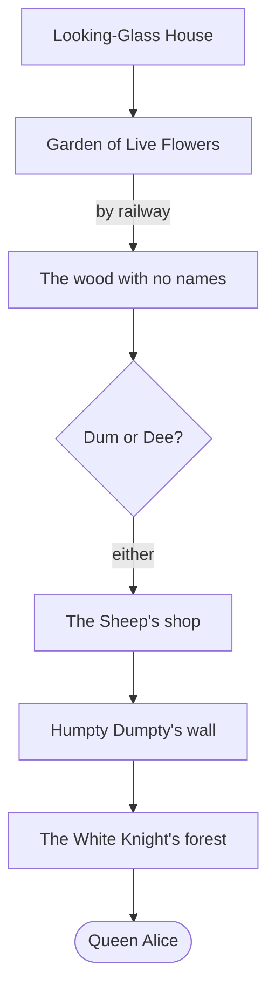
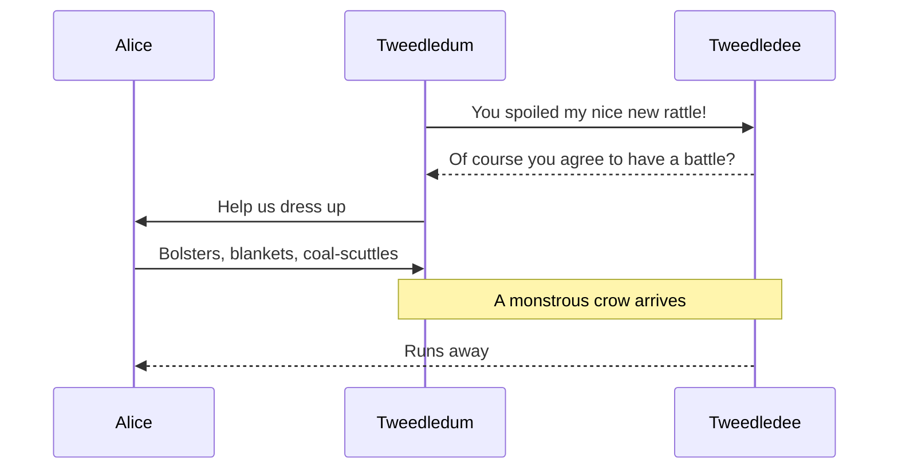
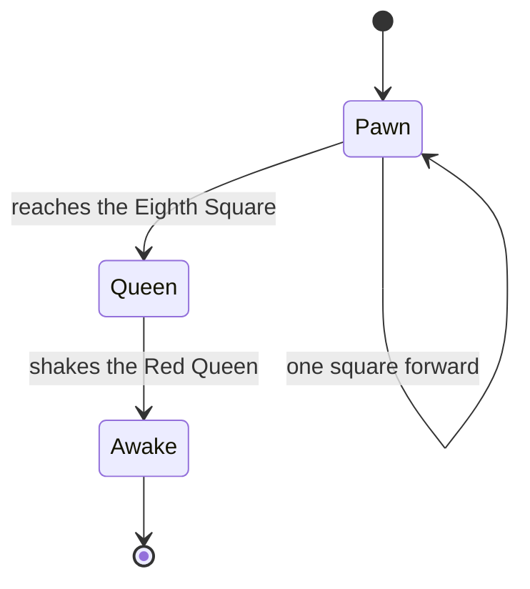
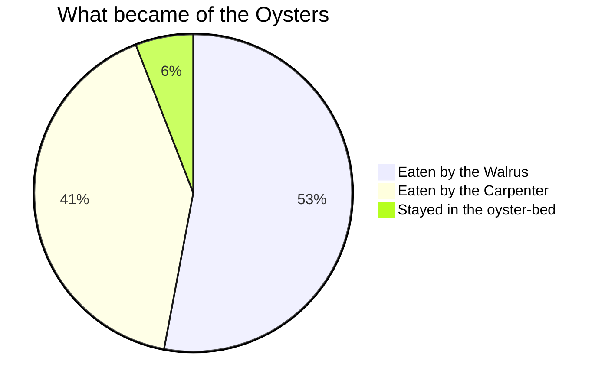
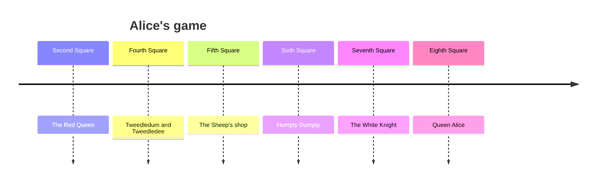
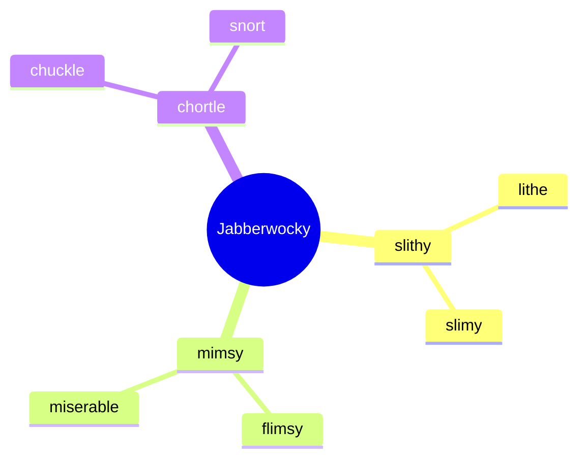

# Through the Looking-Glass

A demo note that crosses the chessboard one feature at a time. Everything above the title is front matter: `ofm-note` shows it as properties, `ofm-markdown` drops it.

## Looking-Glass House

[[Alice]] climbs through the glass over the chimney-piece, with [[Dinah|her cat]] left behind. She finds a poem she cannot read ([[Jabberwocky#The Warning|the warning]] is the clearest part, and [[Jabberwocky#^first-stanza]] the least) and decides to see [[#The Garden of Live Flowers|the garden]] before she has to go back. ^through-the-glass

Tags: #looking-glass, nested #chess/pawn and #chess/queen, unicode #spiegel/königin. A year is not a tag: #1871.

The book is **backwards**, the garden is *alive*, and the hill is ~~straight~~ like a corkscrew. Highlights: ==plain==, ==🔴the Red Queen==, ==🟠a tiger-lily==, ==🟡the gold crown==, ==🟢the little brooks==, ==🔵the Sheep's water==, ==🟣the dusk in the wood==.

One line here%% Alice never sees this %% runs straight on.
A single newline is a line break,
as it should be for verse.

## The Garden of Live Flowers

> [!quote] The Red Queen
> Now, *here*, you see, it takes all the running *you* can do, to keep in the same place.

> [!note]
> A callout with no title takes its type as the title.

> [!tip]+ A foldable callout, open
> Walk **away** from the thing you want to reach. See [[Looking-Glass House]].

> [!faq]- Can flowers talk?
> "We *can* talk," said the Tiger-lily, "when there's anybody worth talking to."

> [!warning] Mind the Queens
> > [!example] Nested
> > A pawn may move two squares on its first move.
> >
> > > [!bug] Nested again
> > > The Rocking-horse-fly lives on sap and sawdust.

> [!info|wide] Metadata after a pipe
> `[!info|wide]` carries `wide` through to the callout.

> [!abstract] Summary
> Abstract, summary and tldr share a colour.

> [!todo] To do
> Reach the Eighth Square.

> [!success] Done
> Second Square to Fourth, by railway.

> [!question] Who is to be master?
> "The question is," said Humpty Dumpty, "which is to be master — that's all."

> [!failure] Missing
> All the King's horses and all the King's men.

> [!danger] Beware
> The Jabberwock, the Jubjub bird, and the frumious Bandersnatch.

> [!jabberwock] An unknown type
> Any type is allowed. Unknown ones get the default colour.

%%
A block comment. None of this is rendered.

## A hidden heading
%%

## Looking-Glass Insects

- Rocking-horse-fly
  - made of wood
  - swings from branch to branch
- Snap-dragon-fly
- Bread-and-butter-fly ^bread-and-butter-fly

1. Go by railway to the Fourth Square
2. Walk through the wood where things have no names
   1. Forget your own name
   2. Remember it again at the far side
3. Meet the twins

- [x] Second Square: meet the Red Queen
- [x] Fourth Square: Tweedledum and Tweedledee
- [/] Fifth Square: mostly water
- [?] Sixth Square: is that an egg?
- [ ] Seventh Square: all forest
- [ ] Eighth Square: Queen Alice

## Tweedledum and Tweedledee

| Piece | Side | Square |
| :-- | :--: | --: |
| [[Alice\|The White Pawn]] | White | `d2` |
| [[Red Queen]] | Red | `e2` |
| [[White Knight]] | White | `f5` |
| The board | ![[chessboard.svg\|48]] | 64 |

^the-pieces

## Wool and Water

An embedded image, by width:

![[chessboard.svg|160]]

By width and height, and a Markdown image with a size:

![[chessboard.svg|120x120]] 

## Humpty Dumpty

"Slithy"[^slithy] is like a portmanteau: two meanings packed up into one word. "Mome raths"[^Raths] takes longer to explain. ^[An inline footnote: Humpty Dumpty can explain *all* the poems that ever were invented.]

[^slithy]: Lithe and slimy.
  "Lithe" is the same as "active."

[^raths]: A rath is a sort of green pig. Labels ignore case.

## Humpty Dumpty's Arithmetic

There are $365 - 1 = 364$ days for un-birthday presents, and only $1$ for birthday presents. Rare glyphs: $\mathfrak{A} \mathscr{L} \mathbb{I} \mathcal{C} \mathfrak{E}$.

$$
\frac{\text{un-birthdays}}{\text{birthdays}} = \frac{365 - 1}{1} = 364
$$

The looking-glass swaps left and right, and doing it twice changes nothing:

$$
M = \begin{pmatrix} -1 & 0 \\ 0 & 1 \end{pmatrix},
\qquad \det M = -1,
\qquad M^2 = I
$$

The Red Queen's race. The ground moves back at speed $u$ while Alice runs at $v$:

$$
\begin{aligned}
x(t) &= x_0 + (v - u)\,t \\
v = u &\implies x(t) = x_0 \\
v = 2u &\implies x(t) = x_0 + u\,t
\end{aligned}
$$

The rule is jam to-morrow and jam yesterday, but never jam to-day:

$$
\operatorname{jam}(d) = \begin{cases}
1 & \text{if } d \neq \text{to-day} \\
0 & \text{if } d = \text{to-day}
\end{cases}
$$

A macro defined in one formula $\gdef\Alice{\mathcal{A}}\gdef\rank#1{r_{#1}}$ is used in the next: $\Alice : \rank{2} \to \rank{8}$. The board she crosses has

$$
\sum_{r=1}^{8} \sum_{f=1}^{8} 1 = 8^2 = 64 \text{ squares, and } \lim_{n \to \infty} \left(1 + \frac{1}{n}\right)^{n} = e \text{ impossible things before breakfast.}
$$

## The White Knight's Inventions

Alice's route, as a flowchart. The first and last nodes are links.



The battle, as a sequence diagram:



A pawn's life, as a state diagram:



What became of the Oysters, as a pie chart:



The game, as a timeline:



Humpty Dumpty's portmanteaus, as a mindmap:



## Looking-Glass Code

Inline code: `mirror("Alice")`. Wikilinks inside code stay as text.

```js
// Hold it up to a glass, and the words go the right way again.
const mirror = (text) => [...text].reverse().join('');

mirror('YKCOWREBBAJ'); // 'JABBERWOCKY'
const notALink = '[[not a link]]';
```

```python
def red_queens_race(speed: float, ground: float = 1.0, seconds: int = 10) -> float:
    """It takes all the running you can do, to keep in the same place."""
    position = 0.0
    for _ in range(seconds):
        position += speed - ground
    return position


assert red_queens_race(1.0) == 0.0   # running, and getting nowhere
assert red_queens_race(2.0) == 10.0  # twice as fast as that
```

```ts
type Piece = { name: string; kind: 'pawn' | 'queen'; rank: number };

const promote = (piece: Piece): Piece =>
  piece.kind === 'pawn' && piece.rank === 8 ? { ...piece, kind: 'queen' } : piece;

promote({ name: 'Alice', kind: 'pawn', rank: 8 });
```

```css
.looking-glass {
  transform: scaleX(-1); /* everything goes the other way */
  filter: blur(0.5px) brightness(1.1);
}
```

```json
{
  "name": "Alice",
  "age": { "years": 7, "months": 6 },
  "kittens": ["Kitty", "Snowdrop"],
  "queen": false
}
```

```bash
# Six impossible things before breakfast
for n in 1 2 3 4 5 6; do
  echo "believing impossible thing $n"
done | tee breakfast.log
```

```diff
 White to play, and win in eleven moves
-Alice: pawn, Second Square
+Alice: queen, Eighth Square
```

```sql
SELECT name, side
FROM pieces
WHERE side = 'red' AND kind <> 'pawn'
ORDER BY name;
```

An unknown language and a fence with no language both stay plain:

```jabberwocky
'Twas brillig, and the slithy toves
```

```
Did gyre and gimble in the wabe
```

## Queen Alice

A whole note, embedded:

![[Jabberwocky]]

One heading's section:

![[Jabberwocky#The Warning]]

One block:

![[Jabberwocky#^first-stanza]]

A note that does not exist:

![[Bandersnatch]]

## Waking

Autolinks: www.gutenberg.org, https://en.wikipedia.org/wiki/Through_the_Looking-Glass, <https://www.gutenberg.org/ebooks/12> and alice@example.com. An [external link](https://en.wikipedia.org/wiki/Lewis_Carroll). A file name such as README.md is not a link.

> A plain blockquote: "You woke me out of oh! such a nice dream!"

---

## Which Dreamed It?

Inert on purpose. Raw HTML and script URLs show as text and do nothing.


<script>document.title = 'pwned'</script>

[[javascript:document.title='pwned']]

$\href{javascript:document.title='pwned'}{link}$
